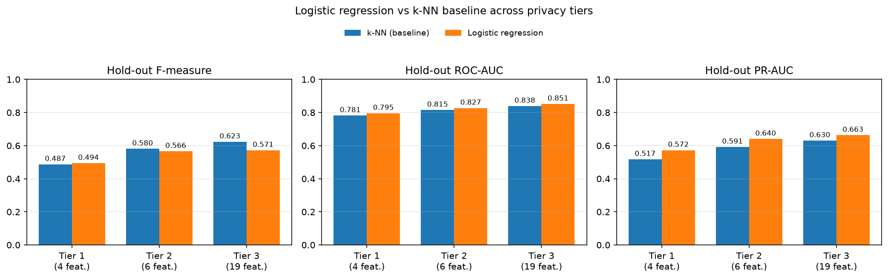

# PRISM (Privacy-Restricted Information for Subscriber Modeling)

Evaluating Privacy-Constrained Feature Subsets for Customer Churn Classification.

## Team Members
* **Abhishek Majumdar** (UG)
* **Dev Parsana** (UG)
* **Ravi Vashi** (UG)

*Department of Computer Science, University of Victoria*

---

## 1. Overview

Churn models are usually trained on everything a telecom company knows about its customers,
including demographics and the services they subscribe to. PRISM asks **how much predictive
power is lost when a model may only use less personal information**.

We define three nested **privacy tiers** of features from the IBM Telco Customer Churn dataset
(7,043 customers, 26.5% churn), each adding more personal information to the one before it:

| Tier | Features | What it adds |
|---|---|---|
| **Tier 1** | 4 | Administrative account terms: Tenure Months, Contract, Payment Method, Paperless Billing |
| **Tier 2** | 6 | + billing amounts: Monthly Charges, Total Charges |
| **Tier 3** | 19 | + demographics and subscribed services (Gender, Senior Citizen, Partner, Dependents, phone and internet services, ...) |

Identifiers, location columns and fields derived from the outcome (Churn Score, CLTV, Churn
Reason) are never used. Full details: [`TIERS.md`](TIERS.md).

For every tier we train two classifiers on **the same cleaned data, the same stratified 80/20
hold-out split and the same 5 stratified cross-validation folds** (seed `2026`):

1. **k-NN (baseline):** z-scored numeric features and one-hot categorical features, Euclidean
   distance, majority vote. `k` is swept from 1 to 20 (extended automatically if the best `k` is
   at the edge) and chosen by mean 5-fold CV F-measure.
2. **Logistic regression (compared against the baseline):** the same preprocessing, trained
   with mini-batch gradient descent implemented in NumPy (adapted from the course notebook).
   Loss function, learning rate, epochs and batch size are chosen by grid search on mean 5-fold CV
   F-measure; churn is predicted when the probability is at least 0.5.

Each model is then refit on the full training set with its chosen setting and scored **once** on
the hold-out test set. Churn (`Churn Value = 1`) is the positive class; we report precision,
recall, F-measure, ROC-AUC and PR-AUC.

## 2. Illustrative Sample

```
raw CSV (7,043 x 33)
   │  clean: keep tier columns + target, Total Charges text -> number (11 blanks -> 0),
   │         drop duplicates / invalid rows (none found)
   ▼
cleaned data (7,043 x 21)  ──►  stratified 80/20 split (seed 2026)
                                   │                         │
                         train (5,634)                 test (1,409)
                                   │                         │
            for each tier ─► 5-fold stratified CV            │
                              ├─ k-NN: choose k              │
                              └─ LR: choose loss, lr,        │
                                      epochs, batch size     │
                                   │                         │
                         refit on all training rows ───────► score once
                                                             │
                                          k-NN vs LR comparison per tier
```

One run prints, for example:

```
Tier 3 TEST (k = 19): [[TP, FP], [FN, TN]] = [[233, 141], [141, 894]]  Precision = 0.623  Recall = 0.623  F-measure = 0.623  ROC-AUC = 0.838  PR-AUC = 0.630
```

## 3. Prerequisites

* Python 3.13 (tested with 3.13.18)
* Pinned packages in [`requirements.txt`](requirements.txt): numpy 2.5.4, pandas 3.0.6,
  scikit-learn 1.9.1, matplotlib 3.11.2, plus seaborn and Jupyter tooling for the notebooks
* The dataset is included at `data/raw/Telco_customer_churn.csv`

## 4. Installation

With pip and a virtual environment:

```bash
git clone https://github.com/ParsanaDev/PRISM-churn-privacy.git
cd PRISM-churn-privacy
python3 -m venv .venv
source .venv/bin/activate          # Windows: .venv\Scripts\activate
pip install -r requirements.txt
```

Or with conda:

```bash
conda env create -f environment.yml
conda activate prism
```

## 5. Quick Start

One command creates the environment, installs the dependencies and runs everything:

```bash
bash quickstart.sh          # k-NN baseline + logistic regression + comparison
bash quickstart.sh --fast   # k-NN baseline only (about a minute)
```

Or, inside an activated environment, from the repository root:

```bash
python src/main.py                  # both models + comparison
python src/main.py --models knn     # only the k-NN baseline
python src/main.py --models lr      # only logistic regression
```

The pipeline writes:

| Path | Contents |
|---|---|
| `data/preprocessed/cleaned_data.csv` | cleaned dataset (regenerated each run, not committed) |
| `output/cleaning_report.json`, `output/run_config.json` | cleaning summary; seed, split sizes and library versions |
| `output/knn/` | per-fold results, k sweep, best k, test results and predictions |
| `output/logistic_regression/` | per-fold results, grid summary, best parameters, test results, predictions, coefficients |
| `output/comparison/test_comparison.csv` | both models side by side per tier |
| `evaluation/results/comparison/model_comparison.png` | comparison chart |

The notebooks in `evaluation/reports/` read these outputs and draw the per-model charts in
`evaluation/results/knn/` and `evaluation/results/logistic_regression/`.

### Project structure

```
├── data/
│   ├── raw/                     # original IBM Telco churn dataset
│   └── preprocessed/            # cleaned data (generated)
├── src/
│   ├── main.py                  # entry point: clean -> split -> k-NN -> LR -> compare
│   ├── compare.py               # k-NN vs logistic regression on the hold-out set
│   ├── cmn/                     # shared by all models
│   │   ├── config.py            #   seed, folds, split size, paths
│   │   ├── tiers.py             #   privacy tier feature lists and target
│   │   ├── data.py              #   cleaning, preprocessing, split, folds
│   │   └── metrics.py           #   precision, recall, F-measure, ROC-AUC, PR-AUC
│   ├── knn/                     # k-NN baseline (model, k sweep, experiment)
│   └── logistic_regression/     # logistic regression (model, grid search, experiment)
├── output/                      # results written by src/main.py
├── evaluation/
│   ├── results/                 # charts (knn/, logistic_regression/, comparison/)
│   └── reports/                 # analysis notebooks
├── milestones/                  # course milestone reports
├── quickstart.sh
├── requirements.txt
└── environment.yml
```

### Reproducibility

Every source of randomness (hold-out split, CV folds, logistic regression weight initialisation
and batch order) uses `SEED = 2026` from `src/cmn/config.py`. Running `python src/main.py` twice in
the same environment produces identical files in `output/`. Library versions used for the
committed results are recorded in `output/run_config.json`.

k-NN on Tier 1 has only one numeric feature, so many customers are at exactly the same distance
from each other; how such ties are broken can differ between machines, which may shift Tier 1
k-NN counts by a few customers. All other results are unaffected.

## 6. Results

Hold-out test set (1,409 customers, 374 churners). CV F is the mean 5-fold cross-validation
F-measure of the setting chosen for that tier. Full tables: `output/comparison/test_comparison.csv`.

| Model | Tier | Chosen setting | CV F | Precision | Recall | F-measure | ROC-AUC | PR-AUC |
|---|---|---|---|---|---|---|---|---|
| k-NN (baseline) | Tier 1 | k = 15 | 0.507 | 0.551 | **0.436** | 0.487 | 0.781 | 0.517 |
| k-NN (baseline) | Tier 2 | k = 13 | 0.563 | **0.620** | **0.545** | **0.580** | 0.815 | 0.591 |
| k-NN (baseline) | Tier 3 | k = 19 | 0.605 | 0.623 | **0.623** | **0.623** | 0.838 | 0.630 |
| Logistic regression | Tier 1 | standard loss, lr 0.5, 200 epochs, batch 32 | **0.546** | **0.610** | 0.414 | **0.494** | **0.795** | **0.572** |
| Logistic regression | Tier 2 | standard loss, lr 0.5, 200 epochs, batch 32 | **0.585** | 0.607 | 0.529 | 0.566 | **0.827** | **0.640** |
| Logistic regression | Tier 3 | standard loss, lr 0.5, 200 epochs, batch 32 | **0.634** | **0.681** | 0.492 | 0.571 | **0.851** | **0.663** |

Bold marks the better model per tier and metric.



* **More information helps both models.** Every metric improves from Tier 1 to Tier 3, for both
  k-NN and logistic regression.
* **Logistic regression ranks customers better** (higher ROC-AUC and PR-AUC in every tier, and
  higher CV F-measure), while **k-NN has the higher hold-out F-measure in Tiers 2 and 3**, because
  logistic regression's fixed 0.5 threshold trades recall for precision.
* The chosen logistic regression setting is at the edge of the grid (largest learning rate and
  number of epochs), so a wider grid might improve it further.

## 7. Citation

```bibtex
@misc{prism2026,
  title        = {{PRISM}: Evaluating Privacy-Constrained Feature Subsets for Customer Churn Classification},
  author       = {Majumdar, Abhishek and Parsana, Dev and Vashi, Ravi},
  year         = {2026},
  howpublished = {\url{https://github.com/ParsanaDev/PRISM-churn-privacy}},
  note         = {Data Mining course project, University of Victoria}
}
```

Dataset: IBM Telco Customer Churn (IBM Cognos Analytics sample data).

## 8. License

Released under the [MIT License](LICENSE).
